<h3><code>reignofoptimus@github ~ $ ./contributions.sh</code></h3>

  

<h3><code>reignofoptimus@github ~ $ whoami</code></h3>
<table>
  <tr>
    <td valign="top">
      
    </td>
    <td valign="top">
      
    </td>
  </tr>
</table>

 

  <a href="https://nirmalmadhu.vercel.app/"><b>Website</b></a> &nbsp;&nbsp;|&nbsp;&nbsp;
  <a href="https://linkedin.com/in/nirmal-madhu-523642361"><b>LinkedIn</b></a> &nbsp;&nbsp;|&nbsp;&nbsp;
  <a href="mailto:nirmalmadhu2005@gmail.com"><b>Email</b></a> &nbsp;&nbsp;|&nbsp;&nbsp;
  <a href="https://instagram.com/iamnirmalmadhu"><b>Instagram</b></a>

