<!-- Every card is an animated SVG drawn by scripts/render_readme_cards.py and refreshed daily
     by .github/workflows/update-profile-art.yml. Design: "Three Worlds" (Paper, Ink, and Three Colours).
     Spacing is baked into the SVGs, so keep this block free of blank lines and keep the cards in
     a row on one line with no spaces between them. -->

 
 
 
 
<picture><source media="(prefers-color-scheme: dark)" srcset="./cards/title-coding-dark.svg" /></picture> 

<a href="https://nirmalmadhu.vercel.app">nirmalmadhu.vercel.app</a> &nbsp;/&nbsp; <a href="https://linkedin.com/in/nirmal-madhu-523642361">linkedin</a> &nbsp;/&nbsp; <a href="mailto:nirmalmadhu2005@gmail.com">email</a> &nbsp;/&nbsp; <a href="https://instagram.com/iamnirmalmadhu">instagram</a>

